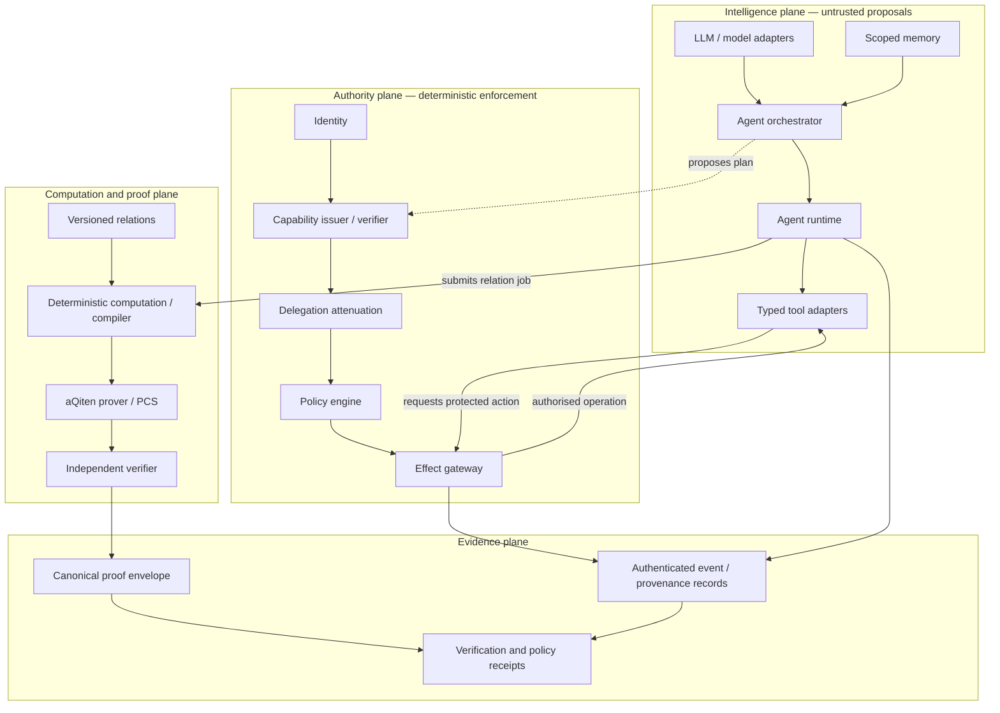

# aQiten platform dependency and trust flow

This is the platform-level diagram. The original `crate_dag.png` depicts only the cryptographic crate DAG.

## Trust interpretation

- The dotted plan edge is a request, not a grant.
- The capability and policy path is deterministic and independent of model judgement.
- The effect gateway is the only path for protected side effects.
- The proof verifier is independent of the agent runtime and prover.
- The evidence plane records different claim types separately; it does not turn signatures or logs into proofs.
- This is a target architecture, not a deployed system.
